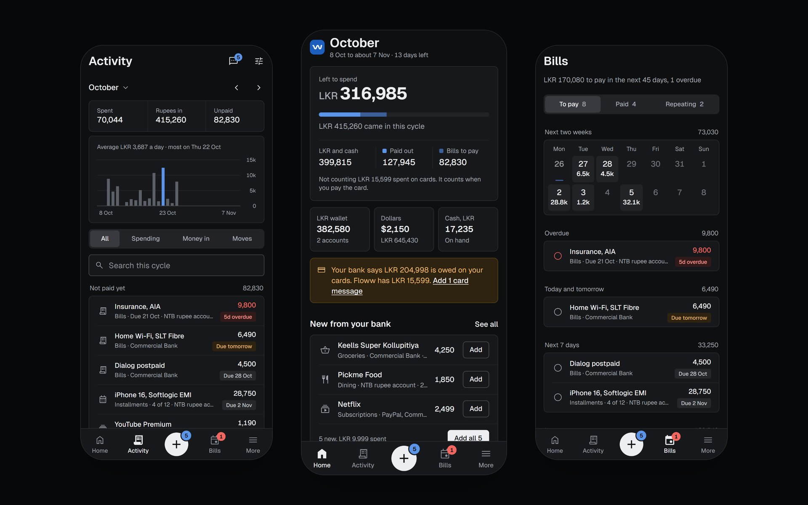
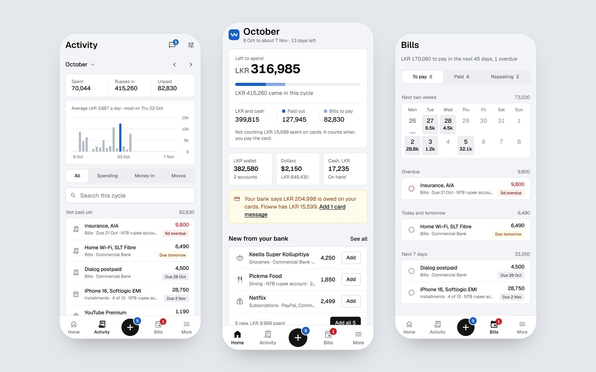

# Floww

A personal finance app for Android. It reads the transaction messages your bank sends by SMS and turns
each one into an expense, then keeps bills, credit cards, loans and savings in view across rupee, dollar
and cash wallets.

Built with Quasar (Vue 3) and Capacitor, with Firebase for sign-in and cloud sync.





The screenshots show the built-in demo data (see "Run in the browser"), not a real person's accounts.

## What it does

**Day to day**
- Home shows what is left to spend in the current pay cycle, what has been paid out and which bills are still to pay.
- Activity lists every expense, income and transfer in the cycle, with search, filters and a daily spending chart.
- Bills collects recurring payments, subscriptions and reminders in a calendar of what is due next.

**Money**
- Wallets for rupee accounts, dollar accounts and cash, with transfers and balance checks against the bank.
- Salary paid in dollars and spent in rupees, with the exchange rate recorded per transfer.
- Credit cards with statements, settlement plans, pay-off tracking and instalments.
- Loans, money lent to other people, net worth and a fuel log.
- Budget limits per category and custom categories.

**Automation**
- Bank SMS import: messages from supported banks are parsed into expenses, income or transfers, and
  matched against what is already recorded so nothing is counted twice.
- Android home-screen widgets for the budget and for spending.
- A monthly report comparing each cycle with the ones before it.

**Data**
- Google sign-in and cloud sync through Firebase Auth and Firestore, one document per user.
- Local backup, restore and export, a trash with restore, and a biometric lock.

The SMS parser is written for Sri Lankan banks (Commercial Bank and Nations Trust Bank messages).
Other banks need their own patterns in `src/utils/smsParser.js`.

## Tech stack

| Layer | Tech |
|-------|------|
| Framework | Quasar 2, Vue 3 (Composition API), Vite |
| State | Pinia with persisted state |
| Backend | Firebase Auth and Firestore |
| Native shell | Capacitor 8 (Android), with Java plugins for SMS reading and widgets |

App ID: `com.floww.finance`

## Getting started

You need Node.js 18 or newer.

```bash
npm install
```

### Run in the browser

```bash
npm run dev
```

Open the address it prints with `?demo` added, for example `http://localhost:9000/?demo#/`.
That loads a sample pay cycle and sample bank messages, so you can look around without signing in.
Add `&theme=dark` or `&theme=light` to pick a theme.

### Use your own Firebase project

Cloud sync and Google sign-in need a Firebase project of your own. The app works locally without one.

1. Create a Firebase project and enable **Authentication** (Google) and **Firestore**.
2. Put the web app config and the OAuth web client ID in [`src/firebase.config.js`](src/firebase.config.js).
3. Put the same web client ID in `src-capacitor/capacitor.config.json` (`GoogleAuth.serverClientId`)
   and in `src-capacitor/android/app/src/main/res/values/strings.xml` (`server_client_id`).
4. Deploy the rules in [`firestore.rules`](firestore.rules). They allow each signed-in user to read
   and write only their own document.
5. For Android, download `google-services.json` from the Firebase console into
   `src-capacitor/android/app/`. It is ignored by git.

### Build the Android app

```bash
npm run build:android
```

The Capacitor project is in `src-capacitor/`. Open `src-capacitor/android` in Android Studio to run it
on a device, or build an APK from there. To sign a release build, create
`src-capacitor/android/keystore.properties` with `storeFile`, `storePassword`, `keyAlias` and
`keyPassword`. That file and any keystore are ignored by git.

## Project structure

```
src/
  pages/          route-level screens (Home, Activity, Bills, Wallets, Credit cards, Loans, ...)
  components/     feature components grouped by domain (accounts, creditCards, expenses, sms, ...)
  composables/    shared logic (SMS inbox, cloud sync, bank checks, monthly report, widgets)
  stores/         Pinia stores (finance, accounts, credit cards, settings, SMS import, trash)
  utils/          SMS parser, export, data integrity, helpers
  boot/           app start-up, including the dev-only demo data
  firebase.config.js   your Firebase project's identifiers
src-capacitor/    Capacitor Android shell with the native SMS and widget plugins
```

## Licence

Personal project. All rights reserved unless stated otherwise.
